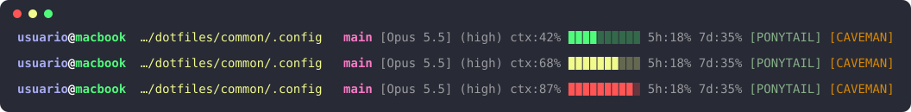

# Claude Code

[Claude Code](https://code.claude.com/docs) es el agente de programación de Anthropic para la terminal. Este repositorio
aporta tres piezas: reglas globales para todas las sesiones, una línea de estado (*statusline*) con datos de la sesión y una
plantilla de ajustes.

## Instalación

Elemento de akmon: `claude`.

| Archivo del repositorio | Destino | Cómo se instala |
|---|---|---|
| `common/.claude/CLAUDE.md` | `~/.claude/CLAUDE.md` | Symlink o akmon |
| `common/.claude/statusline-command.sh` | `~/.claude/statusline-command.sh` | Symlink o akmon |
| `common/.claude/settings.json.example` | `~/.claude/settings.json` | **Fusión a mano** (ver abajo) |

El statusline necesita [`jq`](https://jqlang.org/) (`brew install jq` o `sudo apt install jq`).

## Reglas globales: `CLAUDE.md`

`~/.claude/CLAUDE.md` es la memoria **de usuario**: Claude Code la carga en todas las sesiones del equipo, en cualquier
repositorio o directorio. No es el `CLAUDE.md` que genera `/init` en la raíz de un proyecto, que solo aplica a ese
proyecto. Cuando ambos existen se cargan los dos y sus reglas se suman.

La regla que define este repositorio: **`pnpm` en lugar de `npm` y `npx`**, con su tabla de equivalencias. Se refuerza
fuera del modelo en dos sitios: `settings.json` deniega `Bash(npm *)` y `Bash(npx *)`, y `~/.zshrc` define funciones
`npm` y `npx` que no ejecutan nada (ver [zsh.md](zsh.md)).

## Ajustes: `settings.json.example`

```json
{
  "statusLine": { "type": "command", "command": "bash ~/.claude/statusline-command.sh" },
  "permissions": { "deny": ["Bash(npm *)", "Bash(npx *)"] }
}
```

`~/.claude/settings.json` también guarda tus plugins, tu modelo y otros ajustes locales, así que **no se sobrescribe ni se
enlaza**: copia los bloques `statusLine` y `permissions` dentro del que ya tienes. Si ya existe un `permissions.deny`, añade
las dos reglas a la lista.

## Statusline

<p align="center">
  
</p>
<p align="center">
  <sub>Salida real del script con datos de ejemplo. Las tres filas muestran cómo cambia la barra según el uso del contexto.</sub>
</p>

La primera parte replica el prompt de [Starship](starship.md) (mismos colores y truncado de ruta). La segunda añade los
datos que solo conoce Claude Code y que llegan al script por la entrada estándar en formato JSON:

| Segmento | Ejemplo | De dónde sale | Color |
|---|---|---|---|
| Usuario | `usuario` | `whoami` | Lavanda `#a6aaf1` en negrita (blanco si es `root`) |
| Host | `@macbook` | `hostname -s` | `@` blanco, nombre verde `#50fa7b` |
| Directorio | `…/dotfiles/common/.config` | `.workspace.current_dir` | Amarillo. Más de tres niveles se recortan con `…/` |
| Rama | `main` | `git branch --show-current` | Rosa `#ff79c6`. Solo aparece dentro de un repositorio |
| Modelo | `[Opus 5.5]` | `.model.display_name` | Atenuado |
| Esfuerzo | `(high)` | `.effort.level` | Atenuado |
| Contexto | `ctx:42%` + barra | `.context_window.used_percentage` | Barra de 10 celdas: verde < 60 %, amarillo 60–79 %, rojo ≥ 80 % |
| Límites de uso | `5h:18% 7d:35%` | `.rate_limits.five_hour` y `.seven_day` | Atenuado |
| Plugins | `[PONYTAIL]` `[CAVEMAN]` | Script de cada plugin | El de cada plugin. Solo si está instalado y activo |

Cada segmento de sesión desaparece si su dato no viene en el JSON; por ejemplo, los límites de uso solo existen en planes
con suscripción. A diferencia de Starship, no se muestra la flecha `➜` de éxito o error porque el JSON no trae el código
de salida del último comando.

### Probarlo sin abrir Claude Code

```bash
echo '{"workspace":{"current_dir":"'"$PWD"'"},"model":{"display_name":"Opus 5.5"},"effort":{"level":"high"},
"context_window":{"used_percentage":42},"rate_limits":{"five_hour":{"used_percentage":18},"seven_day":{"used_percentage":35}}}' \
  | bash ~/.claude/statusline-command.sh
```

## Cómo seguir configurándolo

- **Cambiar colores o segmentos**: edita `common/.claude/statusline-command.sh`. Cada bloque cita en un comentario la
  opción de `starship.toml` que replica; si cambias un color en Starship, cámbialo también aquí.
- **Ver qué campos trae el JSON**: la lista completa está en la documentación oficial del statusline (abajo).
- **Añadir reglas globales**: edita `common/.claude/CLAUDE.md`. Lo que solo aplica a un proyecto va en el `CLAUDE.md` de
  ese proyecto, no aquí.

## Documentación oficial

- [Statusline](https://code.claude.com/docs/en/statusline): campos del JSON y ejemplos.
- [Memoria y `CLAUDE.md`](https://code.claude.com/docs/en/memory): niveles (usuario, proyecto, local) y orden de carga.
- [Ajustes](https://code.claude.com/docs/en/settings): `settings.json` y permisos.
